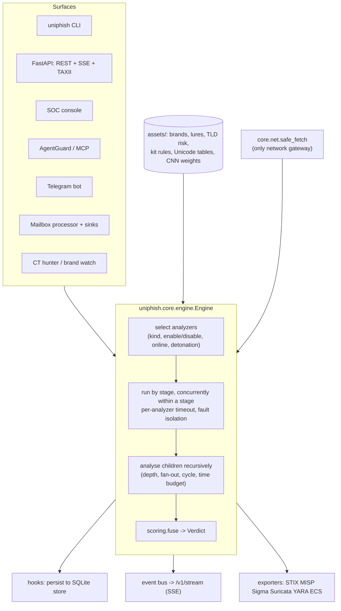

# Architecture

UniPhish 2 is one explainable detection engine with many front doors. This page describes
what exists in the code today, how a scan flows through it, and where to extend it. Where a
number is a hand-set prior rather than something measured, it says so.

Contents: [Data model](#data-model) | [Analyzers and stages](#analyzers-and-stages) |
[Children](#children-recursion-over-links-attachments-and-qr-codes) |
[Fusion](#fusion-how-a-verdict-is-computed) | [Online and active analysis](#online-and-active-analysis) |
[The URL stack](#the-url-stack) | [Persistence and events](#persistence-and-events) |
[Surfaces](#surfaces) | [Configuration](#configuration) | [Extending](#extending-uniphish) |
[Design invariants](#design-invariants)

## Overview



The browser extension is a deliberate exception to "everything goes through the engine": it
carries a JavaScript port of the URL rules, the CNN forward pass and the fusion formula so
that it can run with no server. Parity between the two is covered by tests (Python-generated
fixtures checked by `node --test`), with a short list of documented, intentional deviations
(see [`extension/README.md`](../extension/README.md)).

## Data model

Defined in `uniphish/core/types.py`.

| Type | Role |
|---|---|
| `Artifact` | The thing to analyse: `URL`, `PAGE` (HTML, optionally with its URL), `EMAIL` (raw RFC 5322), `FILE` (attachment, image, download), `TEXT` (SMS, chat, LLM context). Built with `Artifact.from_url/page/email/file/text`; the id is a content-derived SHA-256 prefix. Size caps are enforced at construction: URL 8,192 chars, text 1,000,000 chars, page 5 MB, email and file 25 MB each (`ArtifactTooLarge`). |
| `Signal` | One atomic piece of evidence: stable `id`, `title`, `detail`, signed log-odds `weight`, `category` (evidence family), `confidence`, `evidence` dict, `mitre` ids, optional character `span`, and the fused `contribution`. |
| `Indicator` | An extracted observable (URL, domain, IPv4/6, email, SHA-256/1/MD5, filename, phone, crypto wallet, ASN, certificate hash, user agent) with a `role` (landing, redirect, exfil-endpoint, sender, payload) and a `malicious` tri-state. |
| `BrandMatch` | The brand impersonated (technique: homoglyph, idn, typosquat, combosquat, subdomain, path, bitsquat, content, sender) or legitimately owned (`official=True`). |
| `Verdict` | Result: `risk`, `score`, `logit`, `level`, `action`, `confidence`, `summary`, sorted `signals`, deduplicated `indicators`, `brand`, `techniques`, resolved `mitre`, recursive `children`, per-analyzer `analyzers` run records (ok / error / timeout / skipped), `meta`, `duration_ms`. |

`Level` is `benign | suspicious | malicious`; `Action` is `allow | warn | block`.

## Analyzers and stages

An analyzer subclasses `Analyzer` (`uniphish/core/analyzer.py`), is registered with
`@register`, and declares:

* `name`, `kinds` (artifact kinds it reads), `stage`, `requires_online`,
  `requires_detonation`, `blocking`;
* `signals`: a dict of every signal id it can emit to its title. **This dict is the single
  source for [docs/detections.md](detections.md), the dashboard and `uniphish catalog`.**

Blocking (CPU-bound) analyzers implement `analyze_sync`; async ones implement `analyze`. The
engine runs the analyzers selected for an artifact stage by stage; analyzers in the same
stage run concurrently, and later stages can read earlier results through `ctx.results`.

| Stage | Analyzers | Needs network | Purpose |
|---|---|---|---|
| 0 | `url`, `ml`, `page`, `kits`, `injection`, `text`, `email`, `file` | no | static analysis of the artifact itself |
| 10 | `reputation` | no (feeds optional) | local allow/deny DB, top-site legitimacy, novelty, optional Safe Browsing / VirusTotal / urlscan |
| 20 | `infra` | yes | DNS, RDAP domain age, TLS certificate, hosting ASN |
| 30 | `fetch`, `detonate` | yes (+ opt-in flags) | safe fetch with redirect chain; sandboxed headless-browser render |

Selection rules (`Engine._select`): the artifact kind must match; `AnalysisOptions.enable` /
`disable` filter by name; `requires_online` analyzers are skipped unless the scan is online;
`detonate` also requires `AnalysisOptions.detonate`. `fetch` additionally checks
`fetch_pages` inside the analyzer.

Fault isolation is a hard guarantee: an analyzer that raises or exceeds
`analyzer_timeout_s` (default 10 s) is recorded in `Verdict.analyzers` with status `error` or
`timeout` and the verdict is still produced from the rest. The whole analysis has a time
budget (`timeout_s`, default 30 s). Note the corollary: a *timed-out analyzer silently
removes its evidence*, so check `verdict.analyzers` when a verdict looks too low (this is how
the first-scan cold start shows up, see the README's known issues).

A signal catalogue by analyzer, with counts: [docs/detections.md](detections.md).

## Children: recursion over links, attachments and QR codes

Analyzers may return **child artifacts**: an email yields its links (`email.link`),
attachments (`email.attachment`), images (`email.image`) and attached messages
(`email.attached`); the text analyzer yields the links in a message; the file analyzer yields
URLs found inside a file (`file.url`) and decoded QR payloads (`qr`); the URL analyzer yields
redirect targets; `fetch` and `detonate` yield the landing page as a `PAGE`.

The engine analyses children recursively with bounds: `max_depth` (default 2), `max_children`
per artifact (default 25; overflow is counted in `meta.children_dropped`), a global semaphore
(8 concurrent children), cycle detection by artifact id, and the shared time budget. A
child's verdict is attached under `Verdict.children`, and each suspicious or malicious child
adds an `engine.child.<kind>` signal to its parent (next section).

## Fusion: how a verdict is computed

Implemented in `uniphish/core/scoring.py`. It is intentionally small enough to read in one
sitting.

```text
logit = PRIOR + sum over signals of  weight x confidence x DECAY^rank
risk  = sigmoid(logit)                 PRIOR = -2.0 (about 12 %), DECAY = 0.55, logit clamped to +-12
```

1. **Group** signals by `(category, sign)`. Malicious and benign evidence are damped
   independently.
2. **Rank** within each group by `|weight x confidence|`. The strongest counts in full, the
   next at 0.55, then 0.55^2 = 0.30, and so on. This stops six correlated weak cues (several
   lure words, many hyphens) from adding up to proof, while independent evidence families
   (brand, page, infrastructure, authentication) accumulate fully.
3. **Sum** the damped contributions onto the prior. Each signal's effective `contribution` is
   stored on the signal, so the verdict decomposes exactly; the console draws this as a
   waterfall and the CLI prints it as the "Why this verdict" table.
4. **Decide** with fixed thresholds on risk: below 0.50 `benign`/`allow`; 0.50 to 0.85
   `suspicious`/`warn`; 0.85 and above `malicious`/`block`. They are configurable
   (`UNIPHISH_SUSPICIOUS_THRESHOLD`, `UNIPHISH_MALICIOUS_THRESHOLD`).
5. **Confidence** is `1 - exp(-margin)` where margin is the log-odds distance to the nearest
   threshold: a verdict just above 0.50 is low-confidence even if it is "malicious".
6. **Children** contribute `0.9 x (child.logit - prior)` if the child is suspicious or
   malicious, else nothing: a malicious link makes the email malicious, but benign children
   never whitewash the parent.

Weights are on the scale documented in [detections.md](detections.md): hand-set priors from
domain knowledge, **not** coefficients fitted to data. The evaluation shows the consequence:
good ranking (AUC 0.93 on URLs, 0.98 for rules alone) but poor calibration (ECE 0.145). Read
the score as an ordering and a decomposition, not a literal probability.

Two properties worth knowing:

* **The ML model is just one signal** (`ml.cnn.phishing`, weight shrunk by 0.6 and capped at
  +4.0, or down to -2.5 for benign readings; long URLs are capped lower). Alone it lands at
  about 88/100, which is above the warn line. That is the cause of the 25 % URL
  false-positive rate in [evaluation.md](evaluation.md); the extension solves it by never
  letting the CNN warn without corroboration, and the Python engine has not adopted that yet.
* **Legitimacy is evidence, not an override.** An official brand domain or a top-ranked site
  contributes negative weight; it is withheld for living-off-trusted-sites hosts, shorteners,
  dynamic DNS and open-redirect abuse so a phishing page on `pages.dev` or `sites.google.com`
  gets no reputation bonus.

## Online and active analysis

Everything above runs offline. Network use is opt-in per scan (`online`, plus `fetch_pages`
and `detonate`) and every byte goes through `uniphish.core.net.safe_fetch`, the only
sanctioned gateway:

* resolves the host once, validates **every** resolved IP against an exhaustive non-public
  blocklist (private, loopback, link-local including 169.254.169.254, CGNAT, multicast,
  reserved, and all IPv6 encodings of those), then connects to the pinned IP while keeping
  `Host`, SNI and certificate verification (defeats DNS rebinding);
* follows redirects manually with per-hop validation; rejects numeric, hex and octal IP
  obfuscation; limits ports;
* streams under a wire-size cap and a decompressed-size cap (zip-bomb safe); ignores proxy
  environment variables; persists no cookies;
* never raises: failures come back as `FetchResult.error` or `.blocked_reason`.

`infra` uses DNS, RDAP (cached on disk), a TLS handshake and Team Cymru ASN lookups.
`reputation` can query Google Safe Browsing, VirusTotal and urlscan.io when you supply keys
(`GSB_API_KEY`, `VT_API_KEY`, `URLSCAN_API_KEY`) and skips non-public hosts so internal names
are never sent to third parties. `detonate` renders the page in headless Chromium through
Playwright with sub-resources blocked by default and local and private destinations aborted;
it needs the `sandbox` extra and a browser install, and it is the highest-risk component to
operate (see the [threat model](threat-model.md)).

None of the online path is covered by the published benchmarks.

## The URL stack

URL analysis is the deepest part of the platform and runs in four layers.

| Layer | Module | What it does |
|---|---|---|
| Parse | `uniphish.url.parse` | browser-faithful, hostile-input-hardened parser (raw-authority facts, userinfo tricks, obfuscated IPs, punycode decode) |
| Unicode | `confusables`, `scripts`, `idn_policy` | UTS #39 skeleton and confusables (Unicode 18.0 tables generated by `scripts/gen_unicode_data.py`), script detection and restriction levels, mixed-script and whole-script confusables, invisible, bidi and combining-mark abuse, browser-style IDN display policy |
| Brand and lexical | `brandkb`, `brands`, `lexical`, `techniques` | 680-brand knowledge base (official, login, CDN and user-content domains, native-script names), impersonation by homoglyph, IDN, typo, bit-flip, combo, sub-domain and path; lexical features; classification into 18 attack-construction techniques mapped to MITRE |
| Model | `model`, `saliency` | 377,985-parameter byte-level CNN (UTF-8 bytes, 256 vocabulary, 600-byte window, kernels 2-6) as a pure NumPy forward pass, with batched occlusion saliency to highlight the characters that drove the score |

Reference lists (abused TLDs, living-off-trusted-sites hosts, shorteners, dynamic DNS, open
redirects, lures, freemail, disposable domains, Tranco top 100k) live in `uniphish/assets/`
with provenance in [`uniphish/assets/README.md`](../uniphish/assets/README.md). The TLD
weights and lure lists are judgement-calibrated, not measured likelihood ratios.

## Persistence and events

* **Store** (`uniphish.store`): SQLite (WAL) under `UNIPHISH_DATA_DIR` (default `~/.uniphish`).
  Tables for verdicts, indicators, a reputation allow/deny list with expiry, CT hunt events,
  and STIX objects. The API registers an engine hook that persists every top-level verdict
  (skippable per request with `persist: false`).
* **Event bus** (`uniphish.core.events`): in-process pub/sub with bounded, drop-oldest queues
  so a slow subscriber never blocks a scan. The engine publishes a `verdict` event after each
  top-level scan; hunters and AgentGuard publish alerts. `/v1/stream` relays it as SSE. It is
  per-process: running several API workers means each stream sees only its worker's events.
* **Cache** (`uniphish.core.cache`): TTL/LRU in-memory caches, a single-flight async
  decorator, and a SQLite `DiskCache` used by RDAP and feed lookups.

## Surfaces

| Surface | Code | Notes |
|---|---|---|
| Python | `uniphish.scan_url / scan_text / scan_email / scan_page / scan_file` | thin wrappers over `default_engine()` |
| CLI | `uniphish.cli` | `scan`, `batch`, `export`, `catalog`, `serve`, `hunt`, `version`; `--fail-on` for pipelines |
| REST / SSE / TAXII | `uniphish.server` | [docs/api.md](api.md) |
| SOC console | `web/` | React + TypeScript; built into `uniphish/server/static/` and served at `/` |
| AgentGuard + MCP | `uniphish.agent` | [docs/agentguard.md](agentguard.md) |
| Browser extension | `extension/` | MV3, on-device JS port |
| Telegram bot | `bot/` | `bot.reply` holds the logic; `bot.telegram_bot` the handlers |
| Mailbox + sinks | `uniphish.integrations` | Maildir, mbox, IMAP (network-gated); webhook, Slack, Splunk HEC, Elastic, file, store |
| Hunting | `uniphish.hunt` | CT stream scoring (`CTHunter`), brand permutation watch (`BrandWatch`) |
| Exports | `uniphish.export` | STIX 2.1, MISP, Sigma, Suricata, YARA, ECS |
| LLM analyst | `uniphish.ai` | narrative and triage via the Anthropic API when `ANTHROPIC_API_KEY` is set; deterministic template otherwise. It only ever *describes* a verdict; it never changes the score. |

## Configuration

Read once from the environment (`uniphish/core/config.py`).

| Variable | Default | Meaning |
|---|---|---|
| `UNIPHISH_DATA_DIR` | `~/.uniphish` | database, caches |
| `UNIPHISH_DB` | `<data dir>/uniphish.db` | SQLite path |
| `UNIPHISH_ONLINE` | off | default for online analysis; the API refuses online scans unless this is on |
| `UNIPHISH_SUSPICIOUS_THRESHOLD` / `UNIPHISH_MALICIOUS_THRESHOLD` | 0.50 / 0.85 | decision thresholds on risk |
| `UNIPHISH_API_KEYS` | empty (auth off) | comma-separated accepted keys |
| `UNIPHISH_CORS_ORIGINS` | empty | allowed browser origins |
| `UNIPHISH_RATE_LIMIT` | 120 | requests per minute per key or IP |
| `UNIPHISH_HTTP_TIMEOUT` | 8 s | outbound timeout |
| `UNIPHISH_USER_AGENT` | `UniPhish/2.0 ...` | outbound user agent |
| `UNIPHISH_AI_MODEL`, `ANTHROPIC_API_KEY` | | LLM analyst |
| `VT_API_KEY`, `URLSCAN_API_KEY`, `GSB_API_KEY` | | optional reputation feeds |
| `TELEGRAM_BOT_TOKEN` | | the bot |
| `UNIPHISH_MCP_ONLINE` | off | lets MCP tools use the network when a call also asks for it |

## Extending UniPhish

**Add an analyzer.** Create `uniphish/analyzers/<name>.py`, subclass `Analyzer`, decorate with
`@register`, declare `signals`, return an `AnalyzerResult`, and add the module to
`BUILTIN_MODULES` in `uniphish/analyzers/__init__.py`. Modules are imported tolerantly: a
missing optional dependency skips the analyzer with a log line. Follow the signal conventions
in [`docs/dev/build-contract.md`](dev/build-contract.md): namespaced ids, titles of 70 characters
or fewer, a category, a weight on the documented scale, MITRE ids where they genuinely apply.
Then regenerate [detections.md](detections.md).

**Add data, not code.** Brands (`assets/brands.yaml`), lure terms (`lures.yaml`,
`se_lexicons.yaml`), abused TLDs, living-off-trusted-sites hosts, prompt-injection patterns
and phishing-kit signatures (`assets/rules/kit_signatures.yaml`) are YAML. Kit signature
regexes are linted at load time for ReDoS-prone constructs and a malformed file fails loudly.

**Add an exporter or sink.** Exporters are pure functions of a `Verdict`
(`uniphish/export/`); sinks implement `async send(verdict)` (`uniphish/integrations/sinks.py`).

## Design invariants

These are enforced by code review and tests; a change that breaks one is a bug.

1. **Offline by default.** No network unless the scan is online, and then only through
   `safe_fetch`.
2. **Every input is hostile.** Sizes are bounded, content is never executed or followed,
   XML and SVG go through `defusedxml`, archive extraction is capped, regexes on attacker
   input are ReDoS-safe, file paths inside inputs are never opened.
3. **Explainable by construction.** Every point of risk is a signal with a title and detail
   that a non-expert can read.
4. **Fault isolation.** One analyzer failing never fails a verdict.
5. **Defanged output.** Surfaces that show indicators to humans or agents (CLI, bot, MCP)
   defang URLs and addresses.
6. **Defensive only.** Fixtures are synthetic and inert.
